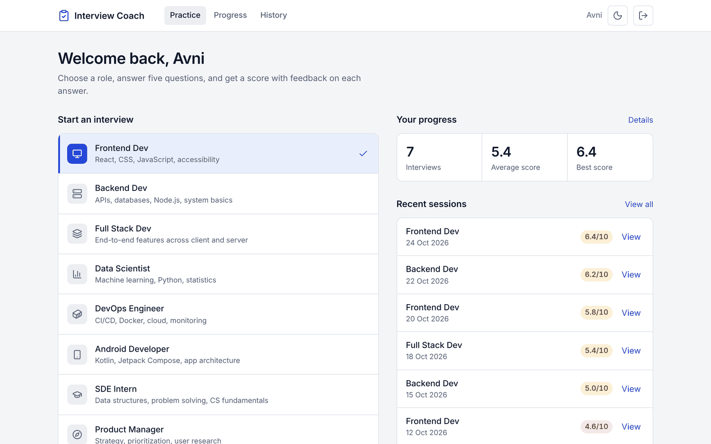
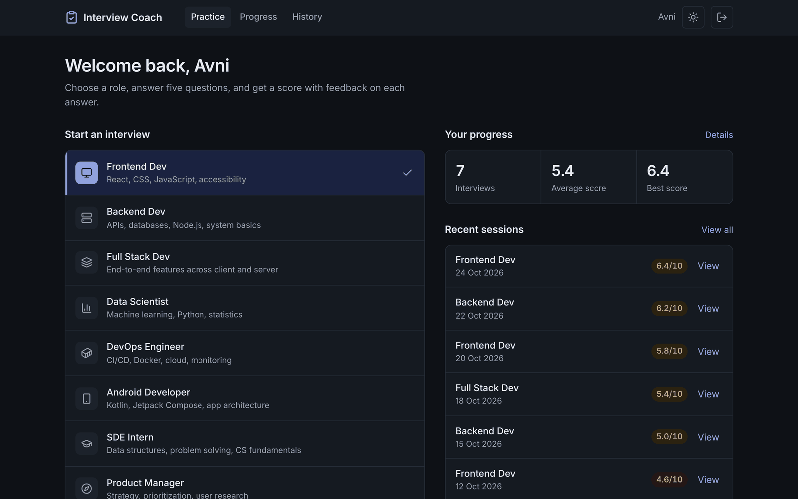
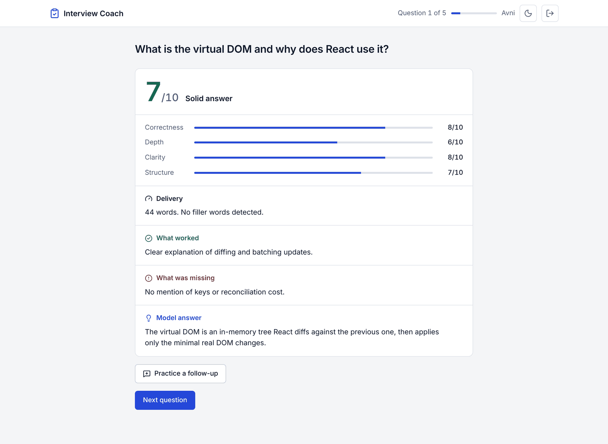
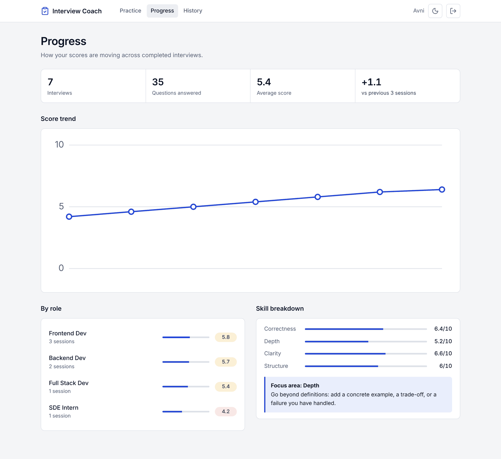
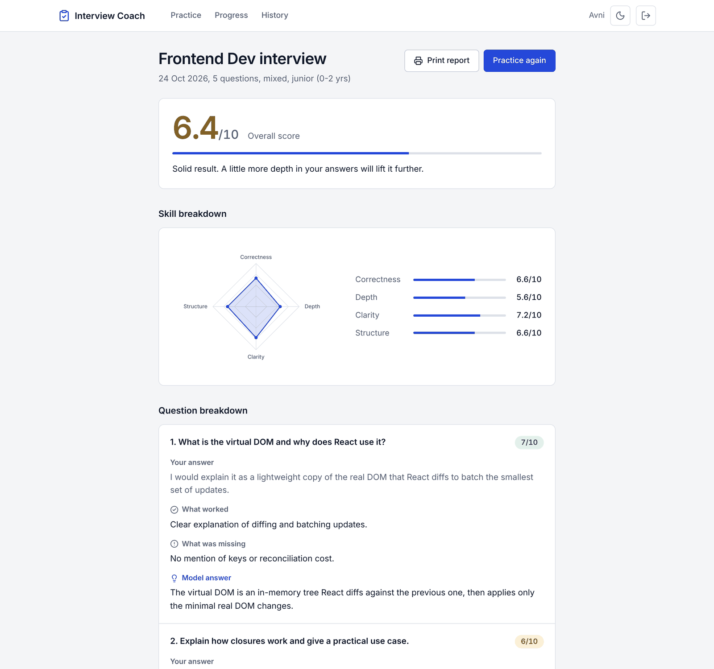
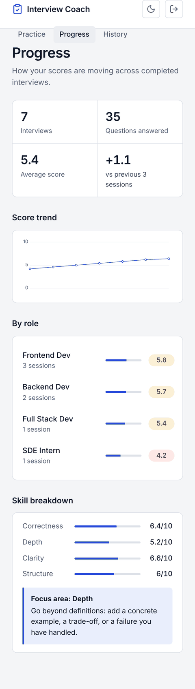
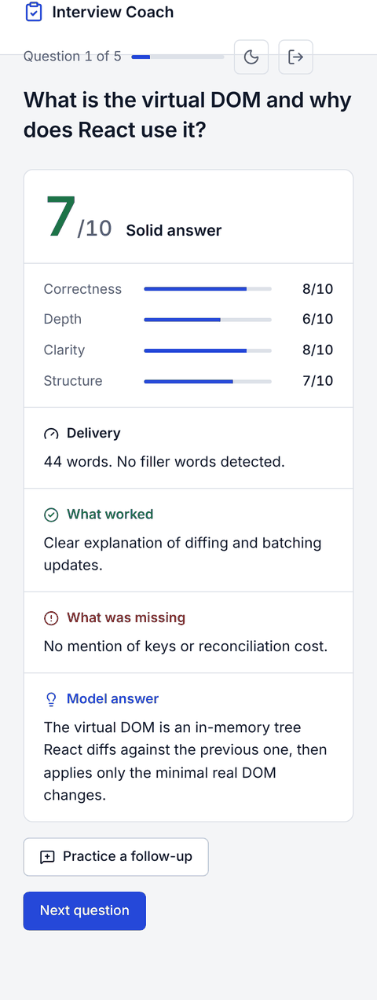
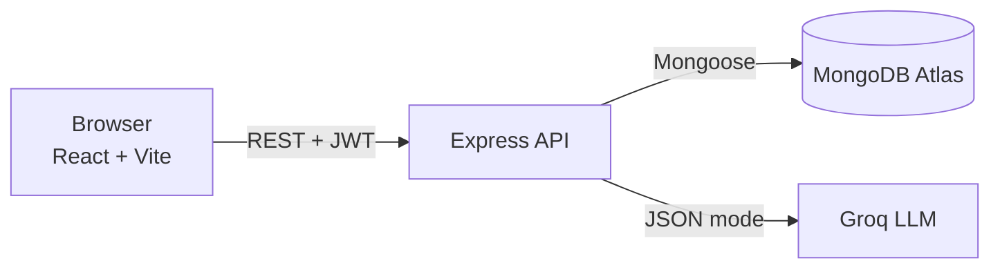

# Interview Coach

> A mock interview app that scores your answers on four skills, tailors questions to your job description or resume, and tracks how you improve over time.

[](https://github.com/Avni-06/interview-coach/actions/workflows/ci.yml)
[](https://interview-coach-sable.vercel.app)
[](https://nodejs.org)
[](https://react.dev)
[](https://mongodb.com)

**Live:** [interview-coach-sable.vercel.app](https://interview-coach-sable.vercel.app). The backend runs on a free Render instance, so the first request after a quiet period can take about 30 seconds.

<p align="center">
  
  
</p>
<p align="center">
  
  
</p>
<p align="center">
  
  
  
</p>

---

## Features

- **Rubric scoring.** Every answer is scored 1-10 on correctness, depth, clarity and structure. The overall score is the rounded mean, computed on the server so it always matches the four dimensions.
- **Tailored interviews.** Paste a job description or your resume and at least three of the five questions are built from it. Resume text has emails and phone numbers redacted before it reaches the model.
- **Interview type and level.** Mixed, technical, behavioral or HR, at intern, junior or mid level. Eight roles to start from.
- **Voice answers.** Speak instead of typing (Chrome and Edge). A live counter flags filler words, and the feedback shows words and fillers for each answer.
- **Follow-up questions.** After an answer, practice one probing follow-up aimed at the gap the evaluator found. It is evaluated but never changes your session score.
- **Progress analytics.** Score trend, per-role averages, skill breakdown, momentum versus your previous sessions, and a focus tip for your weakest skill.
- **History.** Paginated session list with delete (ownership enforced on the server).
- **Report.** Per-question breakdown with a skill radar, printable from the browser.
- **Light and dark themes**, responsive down to phone width.

---

## Architecture



| Layer | Technology |
|-------|-----------|
| Frontend | React 19, Vite, Tailwind CSS 4 (design tokens in CSS variables), Zustand, React Router |
| Backend | Node.js 22, Express 5, Zod validation |
| Database | MongoDB Atlas via Mongoose |
| AI | Groq API, `openai/gpt-oss-120b` by default (`GROQ_MODEL` overrides it) |
| Auth | JWT, bcrypt |
| Delivery | GitHub Actions CI, Vercel (client), Render (server), Docker Compose for local |

---

## How the AI works

1. **Questions.** The server asks the model for five questions as JSON, given role, interview type, level and optional context.
2. **Evaluation.** Each answer is sent with its question. The model returns four 1-10 scores and written feedback. The server clamps scores, computes the overall score and stores everything.
3. **Follow-ups.** The follow-up is generated from the stored answer and the evaluator's "what was missing" note, so the client never sends text the server has to trust.
4. **Reliability.** Every model response is parsed and validated with Zod. Failures are retried with a timeout, and a final failure returns a clean 502 instead of a stack trace.
5. **Prompt injection.** User text is wrapped in `<answer>` and `<context>` tags, and the system prompt tells the model to treat it only as data. Answers that try to manipulate the score are scored 1 on every dimension.

---

## Design decisions

- **Overall score is computed, not asked for.** Models are inconsistent at arithmetic; a mean over four validated numbers is always consistent.
- **Question generation is idempotent.** Refreshing the page or React's double effect must not burn API quota or produce different questions. Concurrent starts share one model call, and the database write is atomic.
- **Follow-ups are practice only.** Mixing them into the score would make sessions with and without follow-ups incomparable.
- **Stats are a pure function.** `buildStats` takes sessions and returns numbers, so it is unit-tested without a database.
- **Solid colors, one accent, no decoration.** The UI uses a small token set so light and dark themes stay consistent.

## Security

Helmet headers, a CORS allowlist, rate limits (stricter on auth), a 100 KB body limit, Zod validation on every route, ObjectId validation, and ownership checks (403) on every session read, write and delete. Passwords are hashed with bcrypt and API errors never expose internals.

## Testing and CI

77 tests (Jest + Supertest) cover validation schemas, LLM response parsing, the API routes including ownership and race conditions, analytics, text redaction and follow-ups. GitHub Actions runs the server tests and a client build on every push.

---

## Getting started

### Prerequisites
- Node.js 22.12+
- MongoDB Atlas account (free tier) or a local MongoDB
- Groq API key (free at [console.groq.com](https://console.groq.com))

### Run locally

```bash
git clone https://github.com/Avni-06/interview-coach.git
cd interview-coach
```

**Server.** Copy `server/.env.example` to `server/.env`, fill in the values, then:
```bash
cd server
npm install
npm run dev
```

**Client.** In `client/.env`:
```
VITE_API_URL=http://localhost:8000/api
```
```bash
cd client
npm install
npm run dev
```

Open [http://localhost:5173](http://localhost:5173).

### Run with Docker

Needs only Docker. This starts MongoDB, the API and the web app together.

```bash
cp .env.example .env        # then set JWT_SECRET and GROQ_API_KEY
docker compose up --build
```

- Web app: [http://localhost:3000](http://localhost:3000)
- API health check: [http://localhost:8000/api/health](http://localhost:8000/api/health)
- Data is kept in the `mongo-data` volume. `docker compose down -v` wipes it.

### Run the tests

```bash
cd server && npm test
```

---

## Project structure

```
interview-coach/
├── client/
│   ├── src/
│   │   ├── api/             # Axios instance
│   │   ├── components/      # Header, charts, rubric bars, follow-up panel
│   │   ├── lib/             # Scoring helpers, speech hook, filler counter
│   │   ├── pages/           # Login, Register, Dashboard, Interview, Results, Progress, History
│   │   └── store/           # Zustand auth and theme stores
│   ├── Dockerfile
│   └── nginx.conf
├── server/
│   ├── config/              # Database connection
│   ├── controllers/         # AI controller (questions, evaluation, follow-ups)
│   ├── middleware/          # Auth, validation, security
│   ├── models/              # User, Session
│   ├── routes/              # Auth, session, AI routes
│   ├── tests/               # Jest + Supertest
│   ├── utils/               # LLM client, analytics, text redaction
│   ├── validators/          # Zod schemas
│   └── Dockerfile
├── docs/screenshots/
└── docker-compose.yml
```

---

## API

| Method | Endpoint | Description | Auth |
|--------|----------|-------------|------|
| POST | `/api/auth/register` | Register | No |
| POST | `/api/auth/login` | Log in | No |
| GET | `/api/health` | Health check | No |
| POST | `/api/sessions` | Create a session (role, type, level, optional JD or resume) | Yes |
| GET | `/api/sessions?page=&limit=` | List your sessions, paginated (`X-Total-Count` header) | Yes |
| GET | `/api/sessions/stats` | Trend, per-role averages, skill breakdown, momentum | Yes |
| GET | `/api/sessions/:id` | Get one session | Yes |
| DELETE | `/api/sessions/:id` | Delete one of your sessions | Yes |
| POST | `/api/ai/start` | Generate the session's questions (idempotent) | Yes |
| POST | `/api/ai/evaluate` | Score an answer on the rubric | Yes |
| POST | `/api/ai/followup` | Generate a follow-up for an answered question | Yes |
| POST | `/api/ai/followup/evaluate` | Evaluate a follow-up answer (not scored) | Yes |

---

## Deployment

| Service | Platform |
|---------|----------|
| Frontend | Vercel |
| Backend | Render (free tier) |
| Database | MongoDB Atlas (free tier) |

---

## Known limitations

- An interview that is closed halfway restarts at question 1 when reopened.
- Scores come from an LLM and are not calibrated against human interviewers. Treat them as guidance, not a verdict.
- Voice input uses the browser's speech recognition, so it works in Chrome and Edge only, needs an internet connection, and often drops "um" and "uh" from the transcript.
- Follow-up answers are stored but not yet shown on the results page.
- No email verification or password reset, and no refresh tokens.
- Free-tier hosting means a cold start after inactivity.

## Roadmap

- Resume an unfinished interview
- Show follow-ups in the report and export it as PDF
- Password reset and email verification
- Timed mock interviews
- Load and error monitoring

---

## License

MIT. Feel free to use this project as inspiration for your own portfolio.

<div align="center">
  Built by <a href="https://github.com/Avni-06">Avni</a>
</div>
